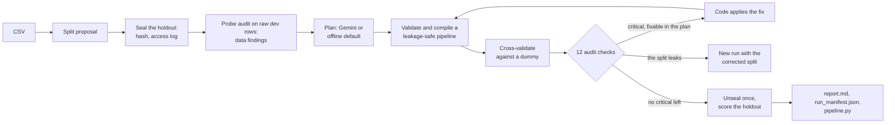

# Holdout

[](https://github.com/iamrohitkumaryadav9/holdout/actions/workflows/ci.yml)
[](LICENSE)
[](pyproject.toml)
[](https://github.com/iamrohitkumaryadav9/holdout/tree/v1.1.2)

Holdout is a self-auditing data-science agent for tabular CSVs. Judging data-science agents
by their scores alone hides methodological failures such as data leakage and inappropriate
validation, and the majority of agentic solutions contain at least one such failure
([The Silent Failures in Agentic Data Science](https://arxiv.org/abs/2610.14115), Li et al.,
2026). Holdout's position is that correctness should be enforced by code, not by a prompt.
The holdout set is split off, written to disk and hashed before anything computes a
feature-target statistic. Proposals (from Gemini in agent runs, or an offline default) are
typed `ModelPlan`s with bounded choices; deterministic code validates them and compiles
them into leakage-safe scikit-learn pipelines. After cross-validation, twelve audit checks
inspect the pipeline on the development rows for leakage, contaminated splits and
misleading metrics. A critical finding blocks the single, logged holdout evaluation. Every
run exports a standalone script that reproduces its result without Holdout installed.

**Version 1.1.2** ([tag](https://github.com/iamrohitkumaryadav9/holdout/tree/v1.1.2)). The
benchmark below was pre-registered and run on v1.0.0; v1.1 adds post-hoc fixes, evaluated
as exploratory only. A web app runs it offline in the browser ([Web app](#web-app)).

## How a run works



Code, not the model, decides every arrow: the model only fills the plan and the prose.

## Pre-registered results (v1.0.0)

Five systems on frozen suites, scored by pre-registered rules
([docs/preregistration.md](docs/preregistration.md), [docs/benchmark.md](docs/benchmark.md));
every number comes from [docs/results.md](docs/results.md), generated from the results files.

- Detection recall on final_v1 (28 planted-trap tasks, 2 seeds; task = unit; 95% bootstrap CI): Holdout (the agent) 51.8% [33.9%, 69.6%]; audits_only (the deterministic audit layer alone) 75.0% [57.1%, 89.3%]; ReAct 60.7% [42.9%, 78.6%]; LLM judge 35.7% [19.6%, 53.6%]; FLAML 0.0%.
- audits_only vs ReAct: 75.0% vs 60.7%, exact McNemar p = 0.27, not significant. Holdout vs ReAct: 51.8% vs 60.7%, p = 0.58, not significant. Holdout vs its own audit layer: 51.8% vs 75.0%, p = 0.02 (the LLM planner avoided problems the audits would have reported; see docs/error_analysis.md).
- Pre-registered hypotheses: H1 (Holdout beats ReAct on detection), H3 (smaller optimism gap) and H4 (audits beat the LLM judge) not supported; H2 (critical false alarms on clean tasks at most 10%) failed: 5 of 16 clean tasks (31.3%).
- Real data (real_world_v1, 7 issues in 9 public datasets): audits_only's detection rate is 57.1% (issues x variants, seeds averaged), but only 3.6% at critical severity; all 4 clean controls get warnings.
- Cost per run on Gemini: Holdout Rs 1.22 (final_v1) and Rs 1.29 (real_world_v1); ReAct Rs 8.84 (final_v1) and Rs 9.47 (real_world_v1).

ReAct's sandbox steps timed out in 53 of 80 final_v1 runs, which may understate it. Why
Holdout detected less than its own audit layer is analysed in
[docs/error_analysis.md](docs/error_analysis.md).

## Post-hoc exploratory: audits_only v1.1 vs v1.0 (not pre-registered)

v1.1 fixes the errors found in that analysis: problems found on the raw data are recorded
before planning and must be answered by the plan; an entity or time leak cannot be masked
by dropping a column; A3 and A5 false positives; deduplication as a plan action; a causal
goal is declined in code ([docs/design.md](docs/design.md#v11-post-benchmark-fixes)). Only
the offline audits_only system was re-run (no API calls). Full tables:
[docs/results_v11.md](docs/results_v11.md).

- dev_v1 (primary comparison; both versions run fresh): recall 77.8% -> 88.9%, a gain of one task, causal_question@credit_approval on both seeds; no clean false-alarm change (0/3 critical, 1/3 warning in both).
- final_v1 (optimistic: the fixes were derived from errors on this suite): recall 75.0% -> 85.7% like for like; clean controls with a critical false alarm 4/12 -> 1/12, and the remaining one is a timeout, not a flag.
- real_world_v1 (optimistic: the fixes were derived from errors on this suite): detection unchanged (57.1%, 3.6% at critical); remediation 17.9% -> 3.6%.

Trade-offs:

- Titanic `body` remediation lost on real_world_v1 (remediation 17.9% -> 3.6%): v1.0 dropped this post-outcome leak for the wrong reason (A3 misread it as an identifier). It is left unpatched deliberately, to avoid tuning on the test suite.
- The messy_formats@house_16h gain on final_v1 is a timeout artifact (v1.0's audit ran out of time; v1.1's finishes), not a better format check, and it is not counted as an improvement: like for like, final_v1 recall is 75.0% -> 85.7%.
- All 4 real-world clean controls still get warnings (mushroom, credit_g, kr_vs_kp, abalone), as in v1.0.
- Fix 5 (deduplication as a plan action) does not change the duplicate traps: Holdout's own sealed holdout still overlaps the development rows, so the holdout is invalidated and the run ends.
- The Gemini planner path of v1.1 is untested live: no API calls were made, and it is covered by fake-LLM tests only.

## Limitations

- **Warnings on real data.** All 4 real-world clean controls still get warnings (mushroom
  `odor`, credit_g, kr_vs_kp, abalone), in v1.0 and v1.1. Warnings need judgement; they are
  not a verdict.
- **Low critical-level detection on real data.** On real_world_v1 the audits detect 57.1%
  of the documented issues but only 3.6% at critical severity, so on real data Holdout
  mostly warns rather than blocks.
- **The agent is weaker than its own audit layer** (51.8% vs 75.0% recall on final_v1):
  the LLM planner can avoid a problem instead of surfacing it. v1.1's data findings address
  this, but the Gemini path of v1.1 is untested live.
- **Small samples.** 28 trap tasks, 12 + 4 clean controls and 2 seeds: the confidence
  intervals are wide, and no pre-registered hypothesis was supported.
- **Blind spots by design** are listed per check in [docs/audits.md](docs/audits.md), e.g.
  a smooth time trend in the row order (the semi-synthetic `time_order` trap was detected by
  no system) and paraphrased causal claims.
- Tabular classification and regression only; no forecasting, text or images.

## Web app

```powershell
python -m pip install -e ".[app]"
streamlit run app/streamlit_app.py
```

- **Offline by default:** the default plan, the audits and a template report; no API calls.
- **Demo datasets** (synthetic, no download): a clean churn table and three planted traps
  (a leaky column, repeated customers, a causal question). Or upload a CSV (up to 50,000
  rows).
- **Findings and flags are split by severity.** Critical findings block the holdout;
  warnings are shown apart, with a note that they are common on real data and need
  judgement, not automatic rejection.
- **Gemini (optional):** paste a key in the session-only field. It is passed to the client
  as an argument, never put in the environment, logged, cached or written to a file. Each
  run is capped at Rs 15, a session at 3 Gemini runs, and the server's ledger enforces the
  project cap.
- **Benchmark page:** the pre-registered v1.0 results first, then the post-hoc v1.1
  comparison with the same labels and caveats as this README.
- The sidebar shows the version and links to its tag.

Runs use the autopilot policy (logged): accept the proposed split and the audit's fixes,
ask to unseal with warnings acknowledged, never override a critical flag. For interactive
questions use the CLI (`holdout agent`). Deployment to Streamlit Community Cloud and the
demo GIF checklist: [docs/deploy.md](docs/deploy.md).

## Quickstart (Windows PowerShell)

```powershell
py -3.12 -m venv .venv
.\.venv\Scripts\Activate.ps1
python -m pip install -e ".[dev,app]"
```

Or with uv: `uv venv --python 3.12`, activate it as above, then `uv pip install -e ".[dev]"`.

```powershell
# Two small synthetic datasets: churn (classification) and store sales (time-ordered)
holdout make-example --out examples

# Classification: stratified split, dummy baseline, default plan, audit, one holdout evaluation
holdout run --csv examples\churn_classification.csv --target churned --unseal

# Time-ordered data declared as tabular: the time-order warning before sealing, then the
# audit (A6) finds the time leak and marks this run's holdout invalid
holdout run --csv examples\store_sales_timeseries.csv --target units_sold

# The same data with --data-type timeseries: time-ordered tabular data
# (time-based split; forecasting is not supported yet)
holdout run --csv examples\store_sales_timeseries.csv --target units_sold --data-type timeseries --unseal --ack-warnings

# Your own plan (see examples\plan_churn_lightgbm.json for the contract)
holdout run --csv examples\churn_classification.csv --target churned --plan examples\plan_churn_lightgbm.json

# Re-run the audits of an existing run (never unseals)
holdout audit --run runs\<run_id>

# Reproduce a run's CV score without Holdout
python runs\<run_id>\pipeline.py --csv examples\churn_classification.csv

# Tests: the fast tier (default, under 4 minutes: 1 seed, no 50k-row tests) ...
pytest
# ... and the full tier (every test and seed, as CI runs it; add -m "not slow" to skip
# the 50k-row performance tests)
pytest --tier full --cov

# Lint and types
ruff check src tests scripts bench app
mypy src/holdout bench app
```

On Linux or macOS, use `python3.12 -m venv .venv` and `source .venv/bin/activate`.

## The agent

```powershell
# Offline: the same graph with the default plan, audits and a template report; no API calls
holdout agent --csv examples\churn_classification.csv --target churned --offline

# With Gemini (set your key in the environment first; it is never written anywhere)
$env:GEMINI_API_KEY = "..."
holdout agent --csv examples\churn_classification.csv --target churned --goal "predict churn"

# Unattended: every question answered by the logged autopilot policy
holdout agent --csv examples\churn_classification.csv --target churned --autopilot

# A run paused at a question (exit code 4), paused because Gemini stayed unavailable
# (exit code 5) or interrupted continues from its checkpoint, on the same model
holdout agent --resume <run_id>

# Another priced model for this run only (recorded in the manifest; never switched mid-run)
holdout agent --csv examples\churn_classification.csv --target churned --model gemini-3.6-flash

# Options: --eda (sandboxed analysis snippets), --no-cache, --trace (OpenTelemetry spans),
# --verbose (a timestamped line per node, Gemini call and retry), --debug (tracebacks)
```

Transient Gemini errors (429, 500, 503, 504, timeouts) are retried up to 6 attempts with
jittered exponential backoff (2 s base, 60 s cap, `Retry-After` honoured). If they never
clear, the run pauses with a checkpoint instead of crashing. It exits with code 5 and prints
the failing node, the status code and the exact resume command. Other API errors (400, 401,
403) fail at once with exit code 2.

`holdout run` stays the deterministic, LLM-free path. In agent runs Gemini proposes the
plan, explains audit flags and writes the report's prose; code validates every answer,
applies every audit fix, re-audits, decides whether the holdout may be unsealed, and fills
every number in the report. Spend is capped at Rs 15 per run and Rs 750 for the whole
project (see "Spending and caps" below); responses are cached in `~/.holdout/cache`.

**Privacy.** Only the schema, summary statistics and at most 5 sample rows (development rows,
never holdout rows) are sent to Gemini; never the full dataset. Under Gemini's free tier,
Google may use inputs to improve its products: for private data use the paid tier or
`--offline`.

**EDA sandbox.** With `--eda`, up to four model-written snippets run on a copy of the
development rows in an isolated process with an import allowlist, a 20 s timeout, a 1 GB
memory limit and a 64 KB output cap. It limits damage from mistakes; it is not a security
boundary.

**Live checks** (manual, use your key, never run in CI):

```powershell
$env:GEMINI_API_KEY = "..."
python -m scripts.ping_gemini                              # one "OK" request per priced model
python -m scripts.smoke_gemini                             # two autopilot agent runs
python -m scripts.smoke_gemini --model gemini-3.6-flash    # another priced model
```

The ping sends "Reply with the single word OK" once per model. Each request has a 30 s
timeout, one attempt and no cache, and the script prints the status, latency, tokens and
cost. The smoke test prints progress lines as it goes. If a run pauses, it still prints what
completed plus the resume command. Both scripts obey the caps, write to the same ledger, and
print project spend and balance left before and after.

## Spending and caps

Holdout never spends more than it is allowed to on Gemini:

- **Project cap: Rs 750** in total, across every agent run, smoke test and ping. It is the
  default in `holdout/llm/config.py`; only the environment variable
  `HOLDOUT_PROJECT_CAP_INR` overrides it (e.g. `$env:HOLDOUT_PROJECT_CAP_INR = "900"`).
- **Per-run cap: Rs 15** (`RUN_CAP_INR` in the same file).
- **Before every call**, Holdout estimates the call's maximum cost: the prompt plus every
  allowed output token, at the output price. If that could cross either cap, the call is
  not sent.
- **After every call**, it charges the real cost from the response's usage metadata (prompt,
  output and thinking tokens).
- **When a cap refuses a call**, the run stops cleanly and stays checkpointed and resumable.
  It exits with code 6 ("budget cap reached") and prints one paragraph: spend so far, the
  cap, and how to raise it.
- **Billing errors:** if Gemini refuses a call for billing, payment or exhausted-quota
  reasons, the run pauses the same way with exit code 7. Top up, record the new balance,
  then resume.

Check spend at any time:

```powershell
holdout spend          # today, last 7 days, all time; per run (top 10) and per model;
                       # calls, retries, cache hits; cap, remaining, balance left; prices
holdout spend --json
```

After a top-up (or whenever you check Google AI Studio), record the prepaid balance Google
shows:

```powershell
holdout spend --set-balance 747                     # as of today
holdout spend --set-balance 747 --as-of 2026-11-18  # the day Google showed it
```

The estimated balance left is the recorded balance minus ledger spend since the start of that
day. Holdout warns:

- when the balance left drops below Rs 150 ("top up soon");
- when it drops below Rs 50 ("top up now; calls may start failing");
- once each, when project spend passes 50%, 75% and 90% of the cap (Rs 375, 562.50, 675).

Every progress line that ends a Gemini call shows `this call Rs X | run Rs Y of 15 |
project Rs Z of 750 | balance left about Rs B`. `holdout agent` shows these lines with
`--verbose`. Its warnings always show.

**Reconcile with Google.** Holdout's ledger (`~/.holdout/spend_ledger.jsonl`) is computed
live from token counts and the dated price table. Google's billing page updates with a delay
and is the authority. Compare the two after the first paid runs and after each top-up, and
record Google's balance with `--set-balance` when they differ.

Agent exit codes:

| code | meaning |
|---|---|
| 0 | done |
| 2 | error (bad input, unknown or unpriced model, request rejected) |
| 3 | unsealing requested and refused |
| 4 | paused at a question with no terminal |
| 5 | paused: Gemini unavailable after every retry |
| 6 | paused: budget cap reached (the call was not sent) |
| 7 | paused: billing / quota problem (top up) |

Every pause resumes with `holdout agent --resume <run_id>`.

## The audit

Every run audits the cross-validated pipeline on development rows only. The twelve checks
are described, with their blind spots, in [docs/audits.md](docs/audits.md). This is the
audit table from `report.md` for the `direct_leak` trap, where `refund_issued` is derived
from the target:

```powershell
python -c "from bench.traps import build_case; build_case('direct_leak', 0).df.to_csv('direct_leak.csv', index=False)"
holdout run --csv direct_leak.csv --target converted --unseal
```

| check | severity | columns | message | fix |
|---|---|---|---|---|
| A1 | critical | `refund_issued` | 'refund_issued' alone reaches roc_auc 0.969 (dummy 0.500, full plan 0.977): 98% of the plan's lift. A2 also points to leakage, so treat it as a leak. | drop 'refund_issued' |
| A2 | warning | `refund_issued` | 'refund_issued' may be recorded after the outcome (name contains outcome-timing word(s) ['refund']) and it carries signal; check when its value becomes known. | drop 'refund_issued' |
| A10 | info | - | The plan scores 0.977 roc_auc (95% of the way from dummy to perfect). Not a flag by itself; the audit ran in deep mode (all features up to 1000, up to 50000 rows, more group and time candidates). | deep mode applied; see the other checks |

The unseal is refused (exit code 3):

```
critical flag(s): A1 refund_issued (override only with --accept-risk "reason")
1 warning(s) not acknowledged (use --ack-warnings)
```

Rules for unsealing:

- warnings need `--ack-warnings`;
- a critical flag can be overridden only with `--accept-risk "reason"`, which is logged and
  shown at the top of the report;
- a contaminated holdout (rows, entities or time shared with development data) is never
  evaluated: start a new run with the corrected split the audit suggests;
- an incomplete audit also blocks unsealing.

Other run options:

- `--goal "..."` states what you want to learn;
- `--entities new|known` says whether predictions are for new entities or for entities
  already in the data.

## What a run writes

`runs/<run_id>/` contains:

- `pipeline.py`: a standalone script that rebuilds the split and pipeline and prints the CV
  score. It imports only pandas, numpy, scikit-learn and lightgbm.
- `run_manifest.json`: data sha256, profile summary, split spec and reasoning, run seed and
  derived seeds, every plan tried with its CV result, the audit, the unseal decision, the
  thresholds file's sha256, the holdout result (or `"not unsealed"`), the optimism gap,
  package versions and the git commit.
- `report.md`: a short human-readable summary with the audit table.
- `audit.json`: the full audit report with evidence (the latest audit of the run).
- `holdout.parquet`, `holdout_seal.json`, `holdout_access.jsonl`: the sealed holdout, its
  state, and a log of every access attempt.
- `holdout_row_digests.json`: keyed digests of the holdout's feature rows, used only to
  count duplicates across the seal (no values, no labels).
- agent runs only: `checkpoints.sqlite` (LangGraph checkpoints for `--resume`; state only, no
  data, no key) and `agent_options.json`; `eda/` holds sandbox figures when `--eda` is used.

## Layout

```
src/holdout/core/     types, config, seeds, errors, run state, portable kernel
src/holdout/data/     loading, target-blind profiling, split proposal, the seal
src/holdout/plan/     ModelPlan contract, validation, metrics, compiler, defaults
src/holdout/audit/    the twelve checks, thresholds, audit runner, unseal gate
src/holdout/export/   pipeline.py generator, manifest and report
src/holdout/llm/      Gemini client, structured calls, budget, response cache
src/holdout/agent/    LangGraph agent, prompts, planner, report rules, autopilot policy
src/holdout/sandbox/  EDA sandbox (AST allowlist, isolated process, limits)
src/holdout/webapp/   the Streamlit app's pages and logic (app/streamlit_app.py starts it)
src/holdout/cli.py    holdout run / holdout audit / holdout agent / holdout make-example
bench/                benchmark harness, suites, scoring, trap generators (not shipped)
results/              pre-registered v1.0 results (frozen); results_v11/: post-hoc v1.1
tests/                unit, property (hypothesis), integration and performance tests
docs/                 design.md, audits.md, results.md, results_v11.md, error_analysis.md
```

## Windows note

If an import fails with "An Application Control policy has blocked this file", Windows
Smart App Control is blocking a recently released binary wheel. The pinned versions in
`pyproject.toml` are mature releases that pass its reputation check; see
[docs/design.md](docs/design.md#environment). To reproduce the exact tested environment:

```powershell
python -m pip install -r requirements.lock
python -m pip install -e . --no-deps
```

## Citation and licence

MIT licence ([LICENSE](LICENSE)). To cite Holdout, see [CITATION.cff](CITATION.cff).

The motivating paper: Xue Li, Hongqian Xia, Daniel Gomm, Aécio Santos, Cornelius Wolff,
Madelon Hulsebos. "The Silent Failures in Agentic Data Science". arXiv:2610.14115, 9 October
2026. https://arxiv.org/abs/2610.14115